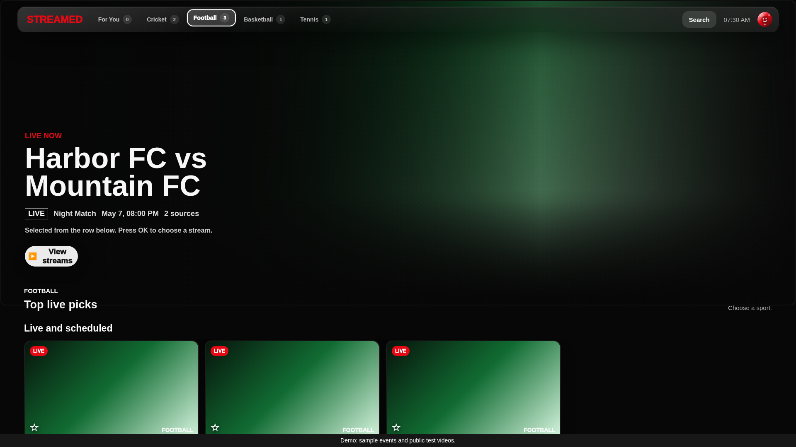
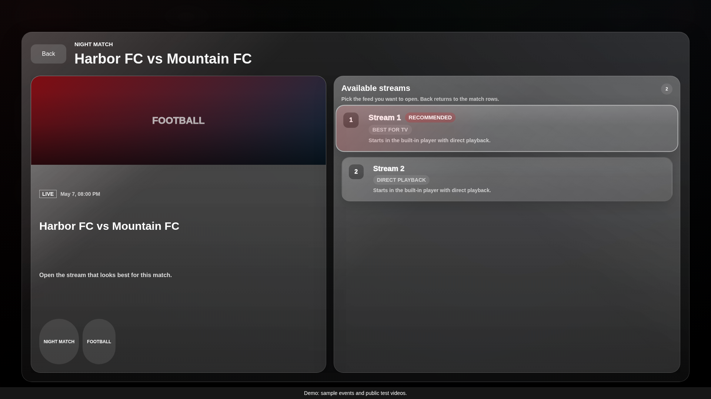
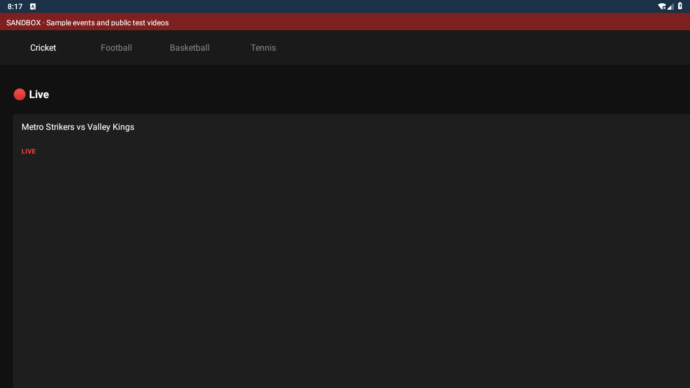

# Streamed

Sports streaming clients and their backend services in one repository. Keeping
these together makes API changes, fixtures, and cross-platform fixes reviewable
in the same change; each platform still has its own build and release status.

| Component | Location | Status |
| --- | --- | --- |
| Browser / Tizen web | [`apps/web`](apps/web) | Browser demo and older Tizen 5.5 / Chromium 69 compatibility checks |
| Tizen .NET / NUI | [`apps/tizen-dotnet`](apps/tizen-dotnet) | Tizen 9 development build; device signing and playback need TV verification |
| Android / MAUI | [`apps/android`](apps/android) | Experimental native playback, remote navigation, and Android/Android TV emulator checks |
| Go backend | [`services/api`](services/api) | Sports, profiles, pairing, configuration, and optional cloud integrations |
| Extractor service | [`services/extractor`](services/extractor) | Separate Go service; production auth/configuration remains separate |

## Try the sandbox

With Node.js 24 installed, run these from the repository root:

```sh
npm ci
npm run sandbox
```

The sandbox listens on port 8080. Open its root path in a local browser, choose
a profile, and select a sport. It uses sample events and public test videos,
requires no credentials, and provides matching fixture APIs for the Android
emulator. See [sandbox instructions](docs/sandbox.md) for Android installation.

For regular web development, copy `apps/web/data/config.example.js` to the ignored
`apps/web/data/config.local.js` without overwriting existing settings, then use
`npm start`. Browser packages and GitHub Pages use clean demo-only settings.

## Builds and tests

```sh
npm run check
npm test
npm run test:browser
npm run test:legacy
npm run build
```

Playwright checks desktop and 720p/1080p TV flows. A separate harness exercises
actual Chromium 69. Native core tests use .NET's test runner and xUnit; backend
services use Go tests. The pinned .NET SDK is in `global.json`. See
[development](docs/development.md) and each component's README for prerequisites.

GitHub Actions runs the web, native, and backend checks. Matching `vVERSION` tags
publish tested browser ZIPs, native development TPK/APKs, and checksums to [Releases](https://github.com/abhishekbindlish1/Streamed/releases).
Successful main builds can deploy the demo once Pages Source is set to GitHub
Actions. Native packages are development previews, not Samsung/Play Store releases.
Android includes an ARM64 device build and an x64 emulator sandbox build. All
downloads inherit the repository’s private access settings. See [publishing](docs/releases.md).
See [TV test environments](docs/tv-testing.md) for Android TV, LG webOS and Samsung Tizen.

## Screenshots

These are real captures of the web fixture sandbox, not renderings of the native
Tizen UI. Android captures, when available, are labeled separately in the
[screenshot gallery](docs/screenshots/README.md).





Actual Android emulator capture of the experimental fixture-only client:



Only use media you own or are authorized to access. No credentials, certificates,
local profile data, or generated backend caches are included in browser builds.
