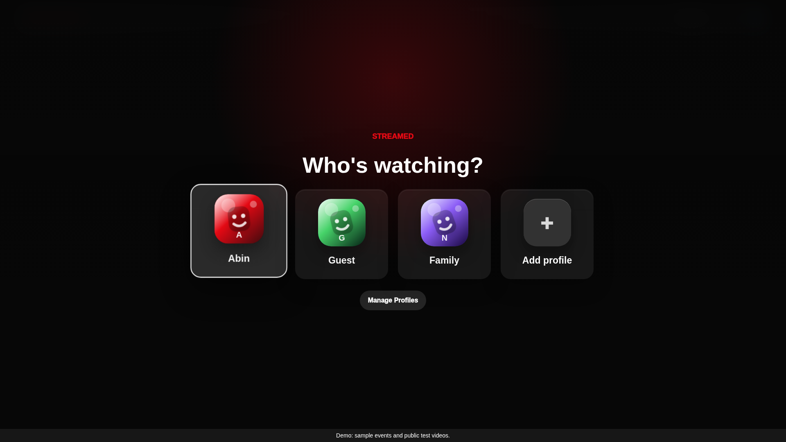
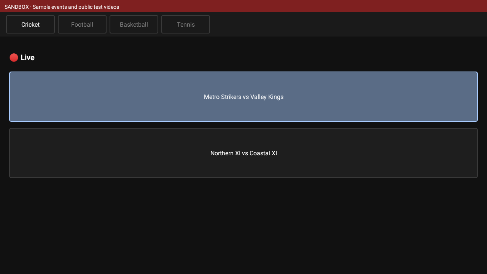
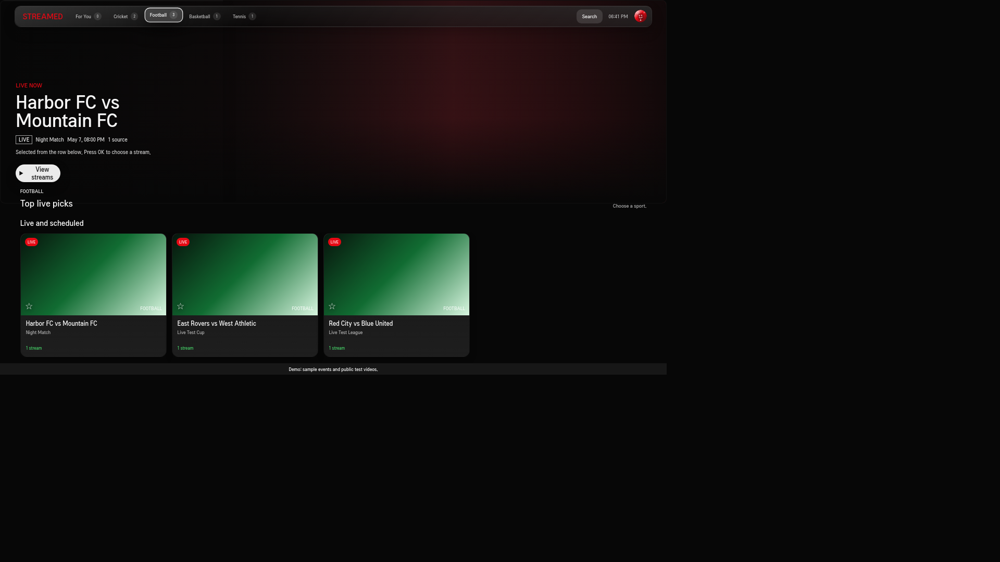

# Screenshots

Real captures of the web fixture sandbox at 1920×1080, using sample content.
These are not renderings of the native Tizen NUI app.

## Browser profiles

## Browser catalog

## Browser stream selection

Regenerate these with `npm run screenshots`. Android images are captured separately
by `scripts/android-smoke.sh` after its UI renders the expected fixture catalog.
Native Tizen captures require a Tizen runtime/device.

## Android sandbox — experimental MAUI port

Actual API 28 Android emulator capture after the APK launched and rendered its
fixture catalog. This is a minimal port, not visual parity with the native TV UI.
Production login, refined card sizing, and media playback need further acceptance
work.

## Android TV 10 compatibility check

Actual Android TV API 29 x86 capture from the diagnostic build used to investigate
32-bit compatibility. The catalog and native page/scroll bounds checks passed
after normalizing MAUI's unset minimum dimensions. This is a native emulator
capture; physical ARM TV acceptance is still pending. See
[the runtime evidence](../tv-testing.md#android-checks) for the limits of this run.

## LG webOS Simulator

The following is a real capture from LG TV 26 Simulator 1.5.0 running the packaged
preview with its offline catalog. It is separate from the browser and Android
captures above; it is not a physical TV capture.

